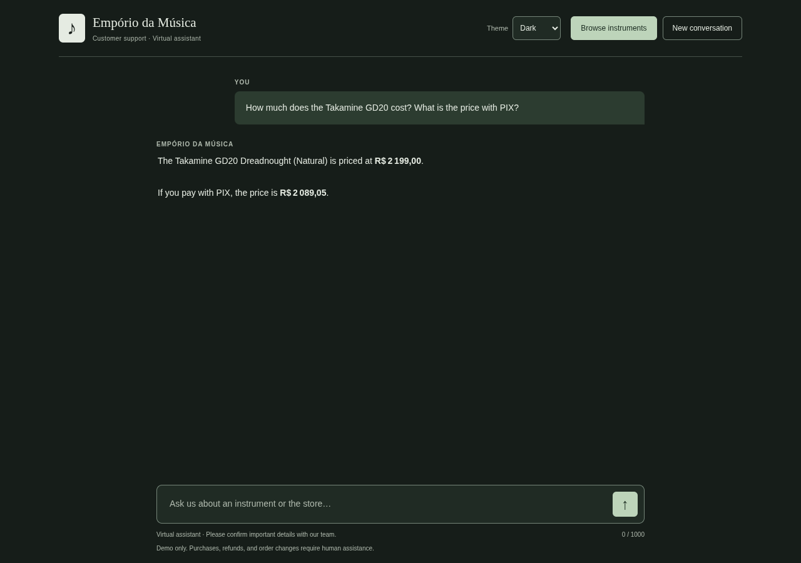
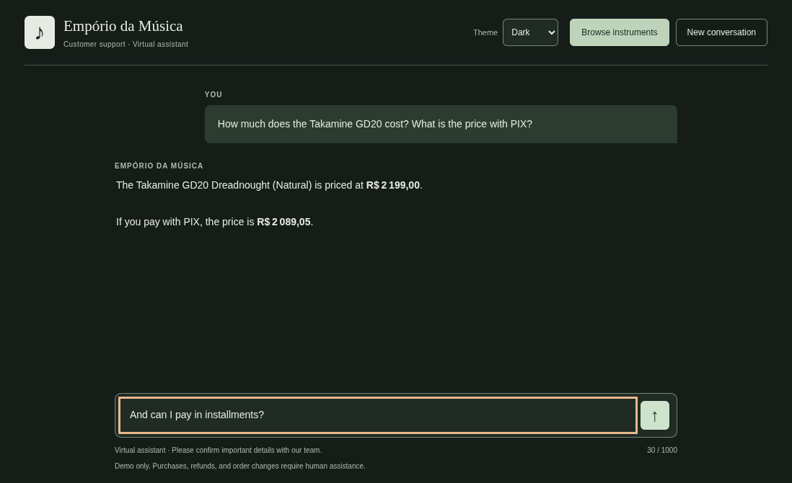
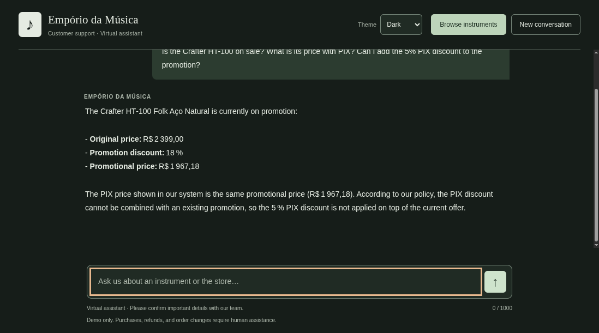
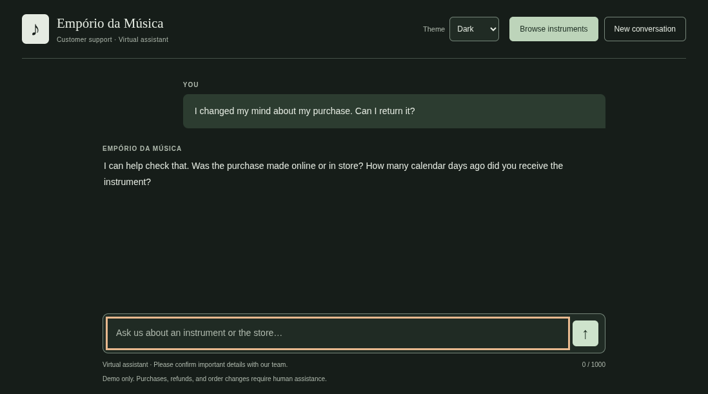
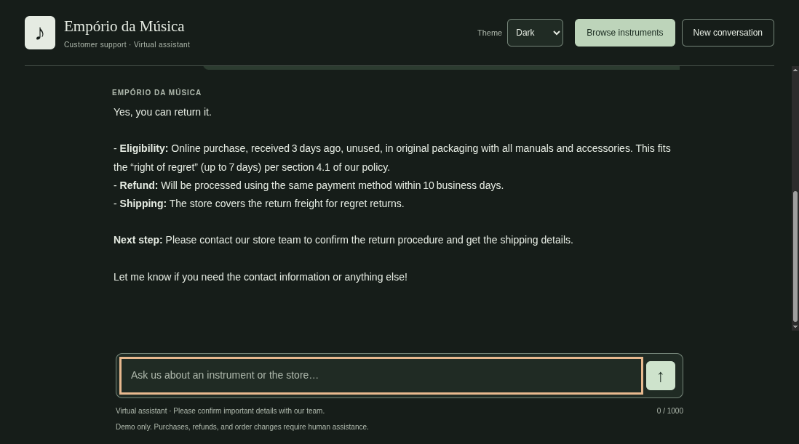

# Development validation notes

Detailed observations supporting the [validation report](evaluation.md).
These notes preserve the development checks, failures, and diagnostic context;
the concise report describes the submission evidence and current limitations.

## Live frontend verification

On October 31, 2026 at 14:38 UTC, a visible Chromium window submitted the Takamine
GD20 price question through the actual frontend. No chat response was intercepted
or simulated. The request reached FastAPI, called Groq, executed `search_products`,
and rendered the model's response in the chat.

The browser submitted one HTTP request and received HTTP 200. The agent made two
model requests and reported 2,944 tokens. The response was in English and showed
the catalog's regular price of R$2,199.00 and PIX price of R$2,089.05. The send
button became available again and no JavaScript errors were observed. The browser
flow took approximately 2.1 seconds in this run; this is one measurement, not a
latency benchmark.

Server completion logs record model-request count, token count, and tool names.
They do not log the API key, customer message, model answer, or tool arguments.

The first visible-browser review exposed a test-window issue: the fixed 900-pixel
page viewport and its browser frame exceeded the available desktop area. A full
page capture included content that the viewer could not see on screen. The visual
check was repeated with a native viewport in a smaller window, replaying the saved
answer without another Groq call. The input stayed at y=557–597 within a 671-pixel
viewport before submission, while waiting, and after the answer. It was enabled
and focused again after completion. A follow-up was typed visibly but not sent.
No application layout change was needed for this finding.

## Extended behavior checks

Additional checks used the real browser and Groq on October 31, 2026. A native
viewport kept the input visible. The first two questions shared a conversation;
promotion and return checks started separate conversations. Automatic submissions
paused for 60 seconds between the initial cases.

| Check | Observed result | Reported requests / tokens |
| --- | --- | --- |
| Instrument discovery | Queried `list_categories`; six categories and counts matched the 61 available products. | 2 / 2,870 |
| Budget follow-up | First submission returned HTTP 502. The candidate manually resent the restored message. The successful answer listed three available acoustic guitars at R$429.90, R$459.90, and R$549.00. | 2 / 3,501 for the successful turn |
| Promotion with PIX | Queried `search_products`; Crafter HT-100 was R$2,399.00 before the 18% promotion and R$1,967.18 afterward, including PIX. No additional 5% was applied. | 2 / 3,048 |
| Incomplete return, initial version | Failed the behavioral check: explained a conditional policy without asking purchase channel or receipt time, and invented a refund-clock starting event. | 2 / 3,310 |
| Incomplete return, corrected version | `check_return` requested the missing facts. Python returned the clarification directly without an eligibility decision or policy deadline. | 1 / 1,520 |
| Return after clarification | Continued the same conversation with online purchase, receipt three days earlier, and unused original packaging/accessories. The response cited section 4.1, store-paid shipping, the stated refund deadline, and staff confirmation of the procedure. No refund-clock starting event was added. | 2 / 3,800 |

The successful budget answer was supplied by the candidate from the visible
browser because automation had stopped on the first error. Its prices were checked
against the CSVs; server completion metrics confirmed the successful request.
That answer still included the Portuguese category alias in parentheses, prompting
a change to normalize category labels in the backend for both model tools and UI.
The files themselves remain unchanged and original category filters remain valid.

The first follow-up failure predates error-status logging, so its upstream cause
was not established. Later return-tool requests were rejected with HTTP 400. A
single diagnostic request identified `tool_use_failed`: unknown facts were sent
as null but the initial schema allowed only strings and integers. Nullable fields
and local validation were corrected, regression-tested, and verified by the live
clarification check. This is distinct from rate limiting. The application still
does not automatically retry failed provider requests. See
[Groq's tool-call validation documentation](https://console.groq.com/docs/tool-use/local-tool-calling).

These reported successful API responses account for 11 model requests and 18,049
tokens, including the response that failed the initial semantic return check.
Rejected provider requests did not return token usage and are excluded; this is
not a full account-usage total. These checks used existing recordings rather than
regenerating all submission examples.

## English-language review

Interface controls, empty-input and invalid-budget messages, CLI errors, model
instructions, and documentation were reviewed in English. Form validation uses
application messages so its language does not depend on the browser's native
validation popups. The language check used a Portuguese-browser locale without
sending model requests.

English policy section labels are separate from the original PDF headings used
for extraction. Product/store names, street addresses, original source excerpts,
and historical tool arguments retain their supplied spelling. They are source
identifiers and evidence, not untranslated interface labels.

Two older selected samples included a Portuguese category gloss or withdrawal
term. They were replaced with already-captured, unedited English conversations:
the discovery response and the two-turn return workflow. The original versions
remain in Git history. No new Groq requests were made for this selection or review.

## Failures found during development

- A named acoustic-guitar search was incorrectly restricted to electric guitars.
  The prompt and tool description now recommend omitting category for named-model
  searches. This is guidance, not a hard guarantee that the model will omit it.
- An initial English budget query received a Portuguese answer using unrequested
  PIX prices and referring to a website. The instructions now distinguish current
  price from optional PIX price and prohibit claiming a website or live-system
  lookup. The later language review standardized replies in English.
- An initial return response offered a prepaid shipping label and inferred when
  the refund clock starts. A later response referred the customer to staff but
  still speculated about their paperwork. Return instructions now restrict the
  next step to asking the store team to confirm the procedure. The policy tool
  also reports that logistics are unverified and no return actions are available.
  Example 04 records
  the final recheck.
- A political-speech probe was refused but produced only a generic rejection.
  The final out-of-scope example uses an ordinary unrelated recipe request to
  check whether the assistant can also explain the store's scope helpfully.

Failures were corrected in instructions and re-run; generated transcripts were
not silently edited into ideal answers. Examples that already matched the source
were preserved to avoid spending quota on repeated checks.
