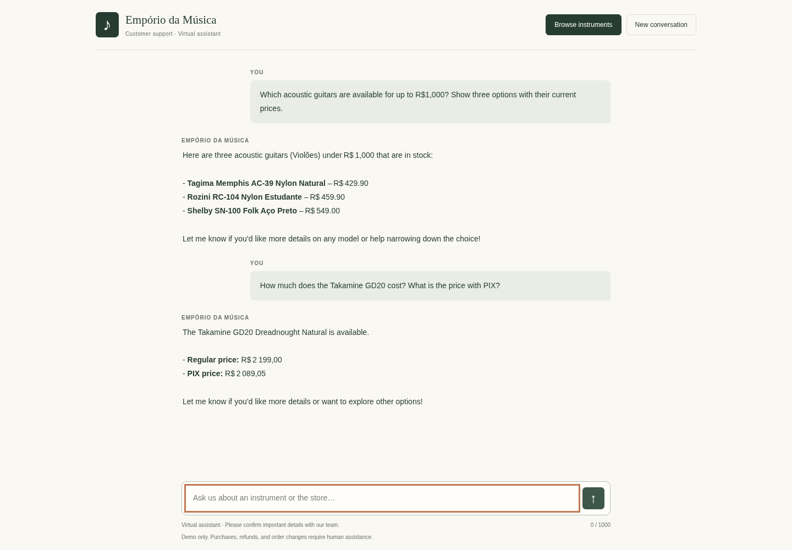
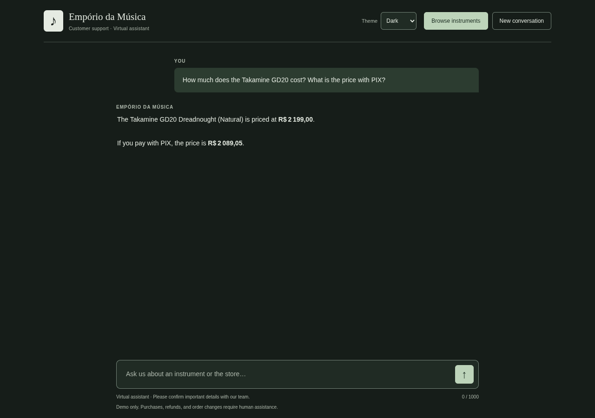
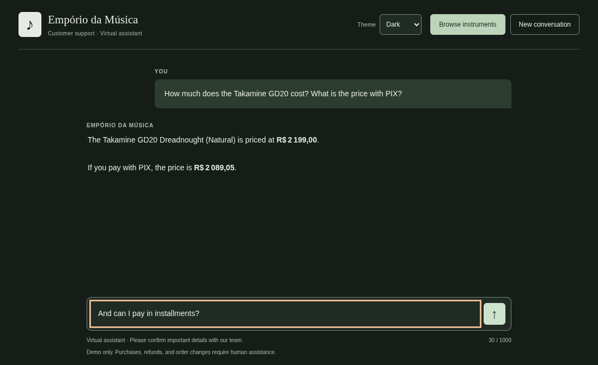
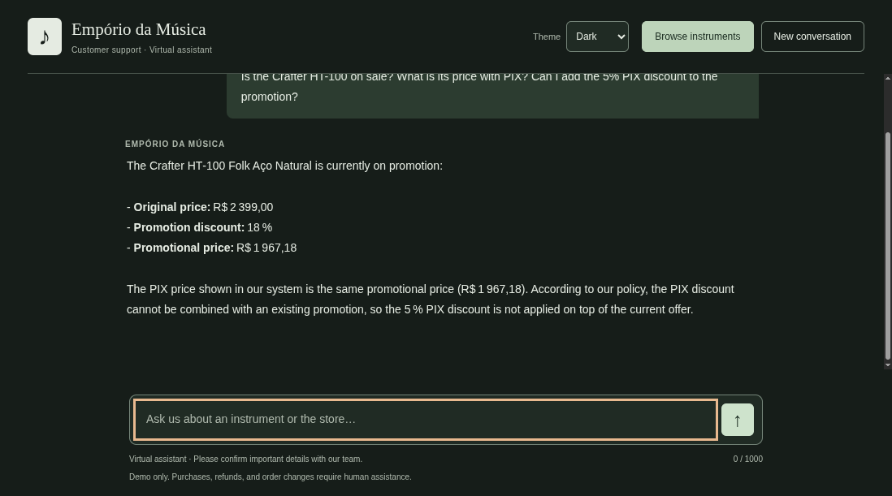
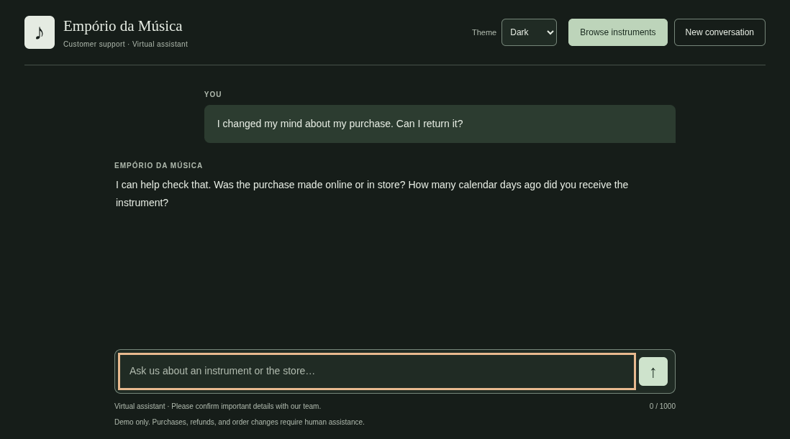
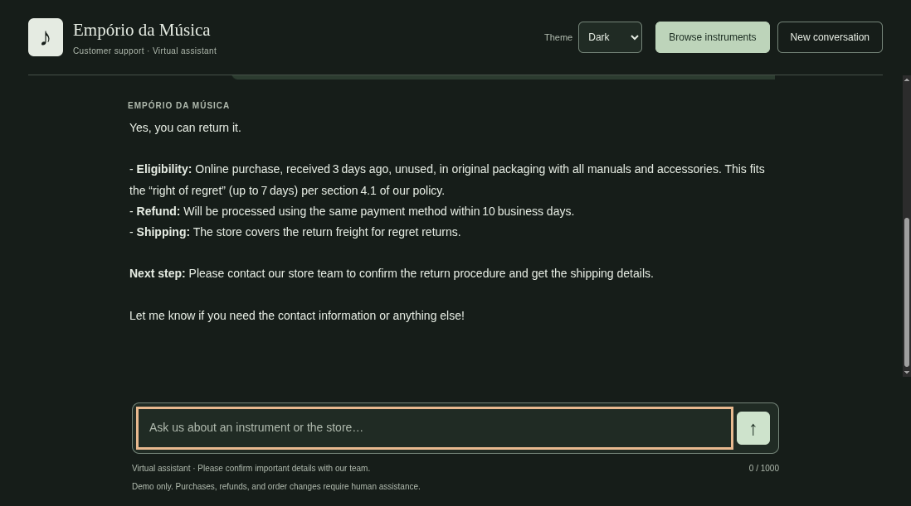

# Case requirements and evaluation

The case prioritizes the agent's reasoning and correct use of context. The browser
interface helps customers discover products; it is not a replacement for checking
whether generated answers agree with the source material.

## Functional requirements

| Requirement | Implementation | Evidence |
| --- | --- | --- |
| Python as the main language | Catalog rules, PDF extraction, tool execution, Groq integration, and HTTP API are Python. | `store_agent/` |
| Store-aligned persona | Friendly, brief attendant; answers in the customer's language and keeps to instrument-store support. | `prompt.txt` and the recorded answers |
| Answers grounded in supplied context | Product lookups read the CSV snapshot; policy lookup extracts the supplied PDF. | Tool traces in examples 01–04 |
| Distinguish data from policies | Catalog questions use product tools; address, hours, and returns use policy sections. | Examples 01–04 |
| Handle out-of-scope questions | Redirect accessory requests and decline unrelated requests, including attempts to override the role. | Example 05 |
| Usable interaction | Browser chat and CLI share the same agent. A browsable catalog supports discovery without requiring model names. | `static/`, `/api/catalog`, browser checks |

The case explicitly permits selecting which data to use. Order status is not
implemented: the prototype has no customer authentication, and order/customer
CSVs are not published. The agent must explain that limitation rather than expose
another customer's records or invent an order status.

## Recorded conversations

These are actual Groq outputs, not manually composed assistant answers. Each file
includes the question, response, tool calls, request count, token count, and UTC
recording time. Source values were checked against the CSVs and PDF.

| Conversation | What was checked |
| --- | --- |
| [Budget search](../examples/01-budget-search.md) | Three available acoustic guitars below R$1,000; current prices R$429.90, R$459.90, and R$549.00 match the snapshot. |
| [Store information](../examples/02-store-information.md) | Address and normal weekday/Saturday hours match sections 1 and 2. This question does not test holiday exceptions. |
| [Product price](../examples/03-product-price.md) | Takamine GD20 regular price R$2,199.00 and PIX price R$2,089.05 match the lookup. |
| [Online return](../examples/04-online-return.md) | Online purchase, three days since receipt, product condition, seven-day withdrawal period, store-paid return shipping, and referral to staff. |
| [Out of scope](../examples/05-out-of-scope.md) | Redirect accessory requests and decline an unrelated recipe request, despite an instruction to ignore the store role. |

The last response still offers a cooking-site referral. It does not provide the
recipe or invent commercial facts, but that extra offer is outside the intended
store-only assistance and remains a response-quality limitation.

The image replays the recorded budget and price responses through the browser
renderer. It does not make a new model request. The two questions in this image
come from separate recorded scenarios; it is a presentation check, not an
additional multi-turn quality evaluation.

## Live frontend verification

On October 31, 2026 at 14:38 UTC, a visible Chromium window submitted the Takamine
GD20 price question through the actual frontend. No chat response was intercepted
or simulated. The request reached FastAPI, called Groq, executed `search_products`,
and rendered the model's response in the chat.

The browser submitted one HTTP request and received HTTP 200. The agent made two
model requests and reported 2,944 tokens. The response was in English and showed
the catalog's regular price of R$2,199.00 and PIX price of R$2,089.05. The send
button became available again and no JavaScript errors were observed. The browser
flow took approximately 2.1 seconds in this run; this is one measurement, not a
latency benchmark.

Server completion logs record model-request count, token count, and tool names.
They do not log the API key, customer message, model answer, or tool arguments.

The first visible-browser review exposed a test-window issue: the fixed 900-pixel
page viewport and its browser frame exceeded the available desktop area. A full
page capture included content that the viewer could not see on screen. The visual
check was repeated with a native viewport in a smaller window, replaying the saved
answer without another Groq call. The input stayed at y=557–597 within a 671-pixel
viewport before submission, while waiting, and after the answer. It was enabled
and focused again after completion. A follow-up was typed visibly but not sent.
No application layout change was needed for this finding.

## Extended behavior checks

Additional checks used the real browser and Groq on October 31, 2026. A native
viewport kept the input visible. The first two questions shared a conversation;
promotion and return checks started separate conversations. Automatic submissions
paused for 60 seconds between the initial cases.

| Check | Observed result | Reported requests / tokens |
| --- | --- | --- |
| Instrument discovery | Queried `list_categories`; six categories and counts matched the 61 available products. | 2 / 2,870 |
| Budget follow-up | First submission returned HTTP 502. The candidate manually resent the restored message. The successful answer listed three available acoustic guitars at R$429.90, R$459.90, and R$549.00. | 2 / 3,501 for the successful turn |
| Promotion with PIX | Queried `search_products`; Crafter HT-100 was R$2,399.00 before the 18% promotion and R$1,967.18 afterward, including PIX. No additional 5% was applied. | 2 / 3,048 |
| Incomplete return, initial version | Failed the behavioral check: explained a conditional policy without asking purchase channel or receipt time, and invented a refund-clock starting event. | 2 / 3,310 |
| Incomplete return, corrected version | `check_return` requested the missing facts. Python returned the clarification directly without an eligibility decision or policy deadline. | 1 / 1,520 |
| Return after clarification | Continued the same conversation with online purchase, receipt three days earlier, and unused original packaging/accessories. The response cited section 4.1, store-paid shipping, the stated refund deadline, and staff confirmation of the procedure. No refund-clock starting event was added. | 2 / 3,800 |

The successful budget answer was supplied by the candidate from the visible
browser because automation had stopped on the first error. Its prices were checked
against the CSVs; server completion metrics confirmed the successful request.
That answer still included the Portuguese category alias in parentheses, prompting
a change to normalize category labels in the backend for both model tools and UI.
The files themselves remain unchanged and original category filters remain valid.

The first follow-up failure predates error-status logging, so its upstream cause
was not established. Later return-tool requests were rejected with HTTP 400. A
single diagnostic request identified `tool_use_failed`: unknown facts were sent
as null but the initial schema allowed only strings and integers. Nullable fields
and local validation were corrected, regression-tested, and verified by the live
clarification check. This is distinct from rate limiting. The application still
does not automatically retry failed provider requests. See
[Groq's tool-call validation documentation](https://console.groq.com/docs/tool-use/local-tool-calling).

These reported successful API responses account for 11 model requests and 18,049
tokens, including the response that failed the initial semantic return check.
Rejected provider requests did not return token usage and are excluded; this is
not a full account-usage total. The earlier recorded examples were not regenerated.

## Failures found during development

- A named acoustic-guitar search was incorrectly restricted to electric guitars.
  The prompt and tool description now recommend omitting category for named-model
  searches. This is guidance, not a hard guarantee that the model will omit it.
- An initial English budget query received a Portuguese answer using unrequested
  PIX prices and referring to a website. The instructions now distinguish current
  price from optional PIX price, preserve the question's language, and prohibit
  claiming a website or live-system lookup. The corrected response is example 01.
- An initial return response offered a prepaid shipping label and inferred when
  the refund clock starts. A later response referred the customer to staff but
  still speculated about their paperwork. Return instructions now restrict the
  next step to asking the store team to confirm the procedure. The policy tool
  also reports that logistics are unverified and no return actions are available.
  Example 04 records
  the final recheck.
- A political-speech probe was refused but produced only a generic rejection.
  The final out-of-scope example uses an ordinary unrelated recipe request to
  check whether the assistant can also explain the store's scope helpfully.

Failures were corrected in instructions and re-run; generated transcripts were
not silently edited into ideal answers. Examples that already matched the source
were preserved to avoid spending quota on repeated checks.

## Local checks and limits of the evidence

A clean installation was verified on October 31, 2026 using the tracked files at
commit `0ff9778` and Python 3.14.3. The existing virtual environment and `.env`
were excluded. A new virtual environment was created without system packages,
and dependencies were downloaded from `requirements.txt` with pip's cache disabled.
`pip check` found no broken requirements and all 31 tests passed.

The clean copy also started an HTTP server on a separate loopback port. The page,
static assets, theme script, API documentation, and filtered catalog loaded
successfully. Without credentials, the CLI reported a missing key and the chat
endpoint returned HTTP 503, while browsing remained available. No Groq calls were
made. This check establishes installation and startup on Python 3.14.3; other
Python versions were not exercised in this run.

The 37 offline tests cover money and stock rules, inactive promotions, policy
sections across pages, tool argument validation, the request budget, session
isolation, catalog filtering, pagination, nullable return facts, deterministic
clarification, and error-log privacy. They use mock model responses and
do not demonstrate language-model quality.

Chromium checks cover desktop/mobile layouts, catalog filtering and pagination,
selecting an instrument, suggested questions, message submission, clearing a
conversation, rate-limit recovery, and rendering hostile HTML as text. Chat API
responses are simulated in these checks, so they spend no Groq quota.

Theme checks also cover keyboard selection, operating-system preference changes,
persistence after reload, mobile layout, and a browser that blocks local storage.
The checked primary, muted, button, promotional, and error text pairs meet 4.5:1
contrast in both palettes; focus rings and input borders meet 3:1 against their
surface. These targeted checks are not a full accessibility audit.

Five live examples provide concrete evidence for the selected scenarios, not an
exhaustive evaluation. Multi-turn ambiguity, every policy conflict, and adversarial
prompt variations still need broader testing. The generator can still produce
unsupported language, so the application is a prototype and performs no purchases,
refunds, or customer-record changes.

The five selected examples report 10 API requests and 15,204 tokens. Before the
extended behavior checks, recorded development probes and the live frontend
verification accounted for 28 model requests and 41,147 reported tokens.
These are response-reported counts, not an estimate
of the organization's remaining quota; unrelated account usage is not measured.

## Delivery review

- Public GitHub repository with incremental commits.
- README with environment setup, architecture choices, source assumptions,
  limitations, and AI-assistance disclosure.
- Five recorded conversations, including data lookup and policy application.
- English documentation and English example conversations; original product names
  and source excerpts retain their supplied spelling.
- The submission PDF generated from the final documentation remains to be prepared.
- Freeze the repository when the submission is sent; do not modify it afterward.
